<div align="center">

<h1>LRH: Lattice Representation Hypothesis</h1>

<p><b>Code, frozen preregistrations, and result summaries for<br>
<i>From Plato to Aristotle: Toward a General Theory of Representation Hypotheses</i></b></p>

[](LICENSE)

[](#citation)
[](https://eethanshi.github.io/LRH/)

<p>
Dai Shi<sup>1</sup> &nbsp;·&nbsp; Andi Han<sup>2</sup> &nbsp;·&nbsp; Xiaoyu Li<sup>3</sup> &nbsp;·&nbsp; Luke Thompson<sup>2</sup> &nbsp;·&nbsp; José Miguel Hernández-Lobato<sup>1</sup>
<br>
<sup>1</sup>University of Cambridge &nbsp;·&nbsp; <sup>2</sup>University of Sydney &nbsp;·&nbsp; <sup>3</sup>University of New South Wales
</p>

<p>
<a href="#in-short">In short</a> ·
<a href="#the-hypothesis">Hypothesis</a> ·
<a href="#key-results">Key results</a> ·
<a href="#limitations-and-open-problems">Limitations</a> ·
<a href="#repository-structure">Structure</a> ·
<a href="#installation">Installation</a> ·
<a href="#reproducing-the-experiments">Reproduction</a> ·
<a href="#preregistration">Preregistration</a> ·
<a href="#citation">Citation</a>
</p>

</div>

<p align="center">
  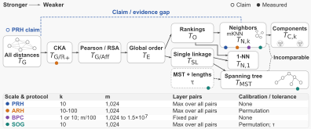
</p>
<p align="center"><sub><b>Figure 1.</b> The lattice of alignment criteria for the four studies, from strongest (left) to weakest (right).</sub></p>

## In short

Four studies reach different conclusions about the structure shared by the same pretrained models: the Platonic Representation Hypothesis (PRH), the Aristotelian Representation Hypothesis (ARH), Back into Plato's Cave (BPC), and Structure over Geometry (SOG). Their alignment criteria form one lattice (Figure 1), and under this lattice view the paper obtains five results.

1. **PRH.** PRH's claim amounts to agreement under the criterion at the top of the lattice, where its idealized learners agree on all distances. Its evidence comes from mKNN, a criterion near the bottom that compares neighbor sets (Proposition 1).
2. **ARH.** The loss of the CKA trend in ARH can come from calibrating a maximum over layers, whose chance level grows with effective dimension (Proposition 4, Corollary 1). On LLaMA-1, calibration turned the trend 0.68 into −0.85, a drop predicted from single-model features, while fixed-depth calibrated CKA keeps its trend and leaves global convergence open.
3. **BPC.** A larger evaluation set at a fixed k draws the neighbor boundary closer to each input, so the collapse of mKNN reported by BPC is at least partly a scale effect (Theorem 1). As in BPC, agreement with sentence encoders (preregistered) and last-layer vision features (exploratory) stays close to stable when k grows in proportion.
4. **SOG.** Every MST contains the nearest-neighbor edge of each input (Proposition 2), and on the studied vision–language pairs these edges make up about 88% of the shared tree edges. The spanning-tree overlap of SOG thus mostly repeats one-nearest-neighbor overlap, while the number of other shared edges exceeds its chance level without an established size trend.
5. **Learning.** The training procedure of a linear autoencoder decides whether distances agree across runs by selecting the invertible map undone by its linear head (Theorem 2). In a finite contrastive model, two learners trained with different contrastive objectives agree on the order of distances and differ in geometry, since they learn one relation through different increasing functions (Theorem 3). Preregistered tests confirm the main predictions of both theorems in these models, whereas results on trained networks outside the premises of the theorems contradict several of these predictions.

## Abstract

> The Platonic Representation Hypothesis (PRH) holds that increasingly capable models converge toward a common representation. However, recent studies have shown different views on aligning representations via their neighborhoods, spanning trees, and distances. We show that these views can differ because the alignment criteria behind them sit at different points of one lattice, and we formalize this explanation as the Lattice Representation Hypothesis (LRH). Under the LRH, the convergence claimed by the PRH is agreement at the top of the lattice, whereas its evidence comes from neighbor overlap, a criterion near the bottom. The Aristotelian Representation Hypothesis (ARH) restricts the claimed convergence to local neighborhoods because calibration keeps the growth of neighbor overlap with model size but largely removes that of centered kernel alignment. We show that this removal can come from calibrating a maximum over layers, so global convergence remains open. Back into Plato's Cave (BPC) infers coarse shared structure from the collapse of neighbor overlap on larger evaluation sets, whereas we trace this collapse at least partly to a fixed number of neighbors covering shorter distances. We verify the spanning-tree overlap reported by Structure over Geometry (SOG) and show that it largely repeats one-nearest-neighbor overlap. The LRH also extends to independently trained models, whose training procedure and objective decide the criteria met reliably across runs. We prove this claim for the training procedure in a linear autoencoder and for the objective in a finite contrastive Gibbs model. Experiments on dozens of pretrained vision and language models and on thousands of runs of both theoretical models support these conclusions. We hope this work paves the way toward a general theory of representation hypotheses, with a framework for analyzing these hypotheses and comparing their evidence.

## The hypothesis

> **Lattice Representation Hypothesis (LRH).** *In the lattice of alignment criteria, the set of criteria accepting two models describes what is shared by their representations. Studies have conflicting conclusions because they apply criteria at different points of this lattice. For independently trained models, the training procedure and the objective decide the criteria met reliably across runs, each in a different part of the lattice.*

An alignment criterion is a test that compares how two models represent a shared set of evaluation samples, through one relation among these samples (for example the neighbor sets in mKNN or the distances in calibrated CKA), and accepts the pair of models if the two relations agree within a tolerance under a fixed scale and protocol. One criterion is stronger than another if every pair accepted by the first is accepted by the second.

<details>
<summary><b>Formal statement (Hypothesis 1)</b></summary>

<br>

**Hypothesis 1 (Lattice Representation Hypothesis).**
(1) For two fixed representations with Gram matrices K<sub>A</sub> and K<sub>B</sub>, the set {Q : (K<sub>A</sub>, K<sub>B</sub>) ∈ 𝒜<sub>Q</sub>} of criteria accepting the pair describes what is shared by the two representations. Studies reach conflicting conclusions about the same models because they apply criteria at different points of the lattice.
(2) For learning conditions (r<sub>A</sub>, r<sub>B</sub>) and a level 1 − δ, let ℛ<sub>δ</sub>(r<sub>A</sub>, r<sub>B</sub>) = {Q : p<sub>Q</sub>(r<sub>A</sub>, r<sub>B</sub>) ≥ 1 − δ} be the set of criteria met reliably across runs. The training procedure, the objective, the sample size, and the model class each decide this set in a different part of the lattice.

</details>

<details>
<summary><b>Theory at a glance</b></summary>

<br>

| Result | In one line |
|---|---|
| Proposition 1 (Two Branches below the Global Order) | The observables form a chain from connected components and neighbor sets through rankings and the global order T<sub>E</sub> up to all distances, with a second branch MST ⪯ single linkage ⪯ T<sub>E</sub>; neighbor sets and spanning trees are incomparable. |
| Theorem 1 (Crossing Law) | The expected fraction of replaced neighbors is κ<sub>i</sub>/k up to O(√κ<sub>i</sub>/k), where κ<sub>i</sub> counts the neighbors pushed across the neighbor boundary; at a fixed k, a larger evaluation set moves this boundary to shorter distances. |
| Proposition 2 (Spanning Trees Contain the Nearest-neighbor Forest) | Every MST contains the nearest-neighbor edge of each input, so MST overlap is bounded from below through one-nearest-neighbor overlap. |
| Proposition 3 (CKA under a Monotone Link and a Residual) | 1 − CKA is approximately the sum of a part caused by a monotone link between the distances of two models and a part caused by the residual around this link; neighbor overlap does not see the link. |
| Proposition 4 and Corollary 1 (Random-pairing Baselines; Aggregation before Calibration) | The chance level of mKNN is k/(m − 1) for every layer pair, whereas that of linear CKA grows with the effective dimension of the layers; if the calibration threshold lies near the largest baseline over layer pairs and this baseline grows faster than the layer maximum, calibration reverses the order of two model pairs. |
| Theorem 2 (The Gauge of a Linear Head) | Gradient flow conserves C = EE<sup>⊤</sup> − W<sup>⊤</sup>W, so the initialization fixes the gauge and two runs disagree in geometry at every sample size; weight decay or tied weights fix one gauge, and all minimizers share the projector. |
| Theorem 3 (Objectives with Different Monotone Links) | In the finite Gibbs model, InfoNCE and the spectral contrastive loss learn one relation through different increasing links, so exact agreement on the order of distances becomes reliable, while criteria on scale-normalized geometry with a small tolerance are asymptotically obstructed. |

</details>

## Key results

Each block gives the Insight of the paper, the figure, the numbers as the paper states them, and what did not hold. The full list of preregistered predictions with their outcomes, failures included, is a table in the paper's appendix.

### 1. The calibration threshold of a layer maximum follows the largest baseline

<sub>Section 5.4 · tests Proposition 4 and Corollary 1 on BLOOMZ, LLaMA-1 and OpenLLaMA (Figure 4) and on Pythia (numbers only, see <a href="experiments/05_layer_max/README.md">experiments/05</a>)</sub>

<p align="center">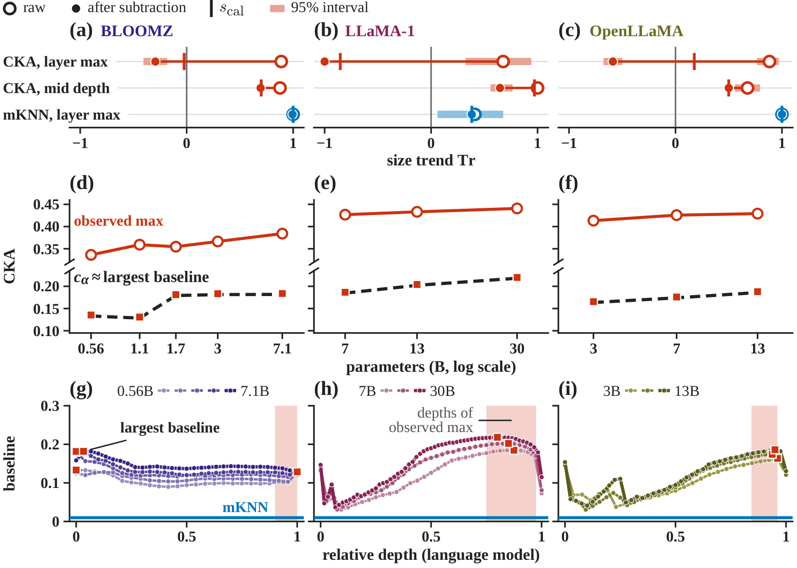</p>
<p align="center"><sub><b>Figure 4.</b> The threshold of a layer maximum follows the largest baseline, so calibration removes or reverses the CKA trend where this baseline keeps pace with raw CKA.</sub></p>

> **Insight.** Our results suggest that the calibration threshold of a layer maximum follows the largest random-pairing baseline of Proposition 4, which supports the assumption of Corollary 1. Along the four families, calibration kept the CKA trend where the raw score outgrew this baseline and removed or reversed the trend elsewhere, in line with this corollary.

**Numbers.** "The trend is lost or reversed along BLOOMZ (0.89 to −0.02 under s<sub>cal</sub> …), LLaMA-1 (0.68 to −0.85), and OpenLLaMA (0.88 to 0.18), where this baseline grows at least as fast as the raw score. It is kept along Pythia (0.93 to 0.89), where the raw score grows faster, by 0.024 per doubling of parameters against 0.0063 for the threshold." Given the raw scores, the thresholds forecast from features "yield a predicted order after calibration in 30 of the 34 comparisons involving OpenLLaMA 13B and in 352 of the 357 Pythia comparisons. Every predicted order is correct." In every family, the trends of mKNN and debiased CKA move by 0.06 or less under calibration, and the CKA trend at mid depth keeps its sign.

**What was forecast.** The threshold follows the largest baseline "in a post hoc analysis on BLOOMZ and as forecast from single-model features on LLaMA-1, OpenLLaMA, and Pythia." For these three families the predictions were fixed and recorded before any score involving their new models was computed.

**Did not hold.**
- Along Pythia, the preregistered prediction of a drop of at least 0.10 was not confirmed.
- On LLaMA-1, calibration of each layer pair before the maximum also reversed the trend, to −0.88, although we had predicted in advance that the trend would keep its sign under this protocol.
- With three sizes each, every exact p-value of a size trend along LLaMA-1 or OpenLLaMA is at least 1/6, and size, depth, and width grow together along these families.
- The loss of the CKA trend under calibration rests on BLOOMZ, LLaMA-1, and OpenLLaMA, with exact one-sided p of at least 1/120 along BLOOMZ and 1/6 along the other two. On Pythia, the one family with a confirmatory test, the raw score outgrew the threshold and calibration kept the trend. The loss of the CKA trend under calibration thus still awaits a confirmatory test on a family that meets the condition of Corollary 1.

### 2. Evaluation size sets the scale of mKNN

<sub>Section 5.2 · Figure 2 · tests Theorem 1 against the collapse of neighbor overlap reported by BPC</sub>

<p align="center">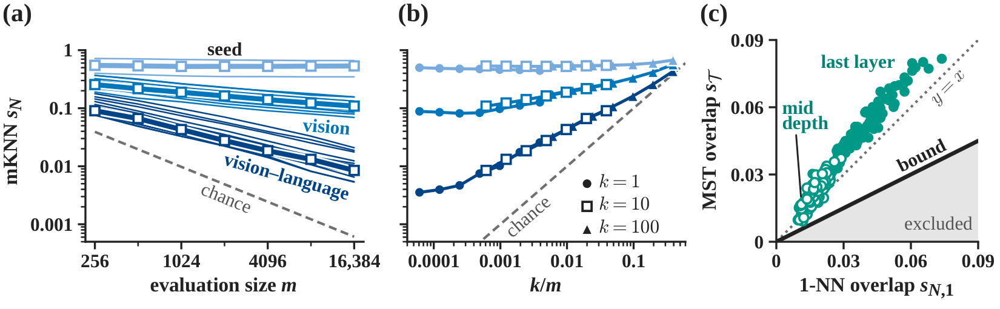</p>
<p align="center"><sub><b>Figure 2.</b> Neighbor overlap changes with the evaluation size at a rate set by the model pair, and spanning-tree overlap tracks one-nearest-neighbor overlap.</sub></p>

> **Insight.** Our results suggest that the evaluation size sets the scale of mKNN and that scores at a shared k/m are comparable across evaluation sets. Both findings support the implication of Theorem 1 and Conjecture D.1 that neighbor overlap depends on the coupling through boundary crossings. With sentence encoders in place of language models, a preregistered test confirms the stability at a shared k/m for k = 10 and k = 100.

**Numbers.** At k = 10, the median mKNN of the vision–language pairs falls from 0.091 to 0.0085 as the COCO evaluation set grows from m = 256 to 16,384 images. "The slope of ln s<sub>N</sub> on ln m is set by the model pair, with medians of −0.57 for vision–language pairs, −0.21 for pairs of vision models, and −0.01 for pairs of Pythia-410M models, against −1.00 for chance." The medians for k = 100 lie within 4% of those for k = 10 at a shared k/m, whereas those for k = 1 differ by up to 19%. The collapse of mKNN reported by BPC is thus at least partly a scale effect.

**Did not hold.**
- The preregistered out-of-sample test of the crossing law needed an estimator of the coupling, and every candidate estimator failed the preliminary check against two baseline predictors on synthetic couplings. The test was not run, so panels (a) and (b) are reported as measurements, not as outcomes of preregistered tests.
- The rising class was absent, but our slope rule also classifies a synthetic coupling of this class as flat, which leaves the prediction for this class untested.
- With sentence encoders, two preregistered predictions linking the slope to the level of mKNN remained undecided.
- For the vision–language pairs, the agreement predicted by the crossing law with an estimated coupling is too high, with a larger error than a no-change null.

### 3. Spanning-tree overlap comes mostly from the nearest-neighbor forest, and the CKA deficit mostly from a residual

<sub>Section 5.3 · Figures 2c and 3 · tests Propositions 2 and 3 against the spanning-tree evidence of SOG</sub>

<p align="center">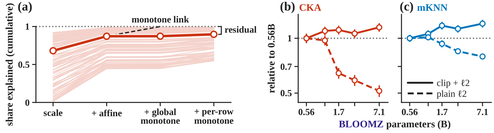</p>
<p align="center"><sub><b>Figure 3.</b> Beyond an affine change of scale, pretrained vision and language representations differ by a residual, not a monotone link, and preprocessing can reverse size trends.</sub></p>

> **Insight.** Our results suggest that on these pretrained pairs, spanning-tree overlap comes mostly from the nearest-neighbor forest of Proposition 2 and the deficit 1 − CKA mostly from the residual of Proposition 3, rather than from a monotone link.

**Numbers.** On a larger evaluation set of m = 2047 inputs, "the nearest-neighbor forest makes up a median 0.875 and 0.889 of the shared MST edges at mid depth and the last layer, near its 84 to 85% share of each tree." The preregistered rule classifies MST overlap as mostly one-nearest-neighbor overlap at both depths, although its conditions on the forest share and on s<sub>T</sub> − s<sub>N,1</sub> hold nearly automatically. As a preregistered check rather than a confirmatory test, we fit increasingly flexible maps between squared distances: beyond an affine fit, a global monotone fit explains a further median 0.0004 and 0.0012 of the squared-distance discrepancy, below the preregistered level of 0.10 in all 136 pairs. At mid depth and after subtraction of the permutation mean, the BLOOMZ trends of CKA and mKNN are 0.70 and 0.84 with the preprocessing of PRH and reverse to −1.00 and −0.92 under plain ℓ<sub>2</sub> normalization.

**Open.** "Bridge overlap exceeds its permutation null in 93% and 100% of pairs, but its BLOOMZ size trend at the last layer stays unresolved (trend 0.57, Holm-adjusted p = 0.23)." The number of shared edges outside the forest thus exceeds its chance level without an established size trend.

### 4. The training procedure selects the gauge of a linear head

<sub>Section 5.5 · Figure 5 · tests Theorem 2 in a linear autoencoder and in CIFAR-5m networks with a linear head</sub>

<p align="center">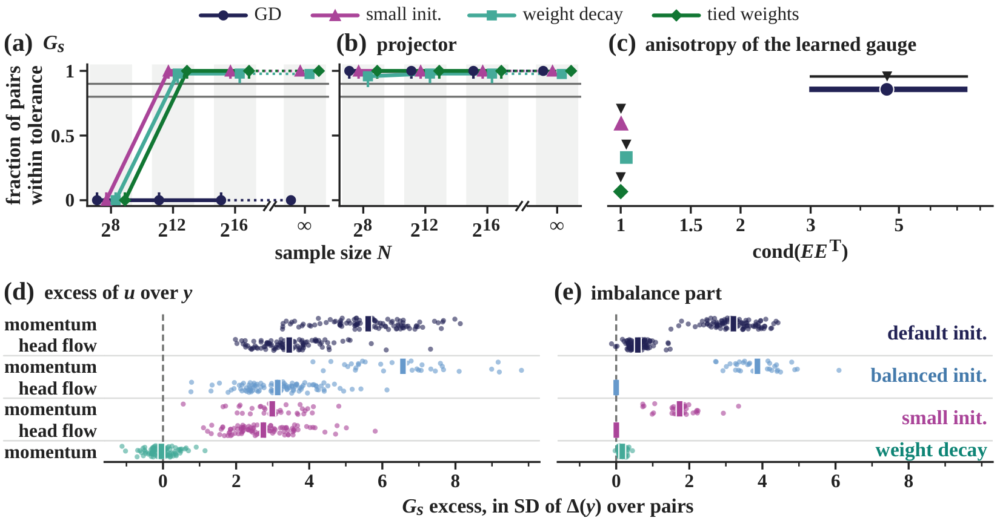</p>
<p align="center"><sub><b>Figure 5.</b> Gradient flow keeps the gauge set by the initial imbalance of a linear head at every sample size, and weight decay removes the resulting disagreement on G<sub>s</sub>.</sub></p>

> **Insight.** Our results suggest that weight decay, tied weights, and small initialization each fix one gauge of the linear autoencoder, which confirms the preregistered predictions of Theorem 2 for these three training procedures. They also suggest that gradient descent at a small step keeps the gauge set by the initialization, which supports part 1 of the theorem. In trained networks, the imbalance kept by head flow and the imbalance created by momentum both add an excess to the geometric discrepancy of u between two runs, and weight decay removes this excess on G<sub>s</sub>, which supports Remark 1.

**Numbers.** Under gradient descent without a regularizer, the criteria on neighbor sets, mean-normalized squared distances (G<sub>s</sub>), and CKA each accepted 0 of 48 pairs of runs at every finite N and 0 of 500 at N = ∞. With weight decay, tied weights, or small initialization, agreement under these criteria was reliable for N ≥ 2<sup>12</sup>. Outside the preregistered tests, the medians of the condition number of the learned EE<sup>⊤</sup> are 4.66 against 4.67 predicted under a small step close to gradient flow and 1.0330 against 1.0329 under weight decay.

**Did not hold.**
- In the linear autoencoder, the preregistered prediction for gradient descent also required the mean discrepancy at N = 2<sup>16</sup> to lie inside the 95% interval of this mean at N = ∞, and this part failed on G<sub>s</sub> and CKA.
- In CIFAR-5m networks without weight decay, u agreed on neighbor sets in 96 of 96 pairs at 250,000 images, contrary to the preregistered prediction that this agreement would be unreliable at both sizes. Several further network predictions failed; the paper lists each one.

### 5. In the finite Gibbs model, learners trained with different objectives agree on order and differ by the link

<sub>Section 5.6 · Figure 6 · tests Theorem 3 inside its premises and in CIFAR-5m networks outside them</sub>

<p align="center">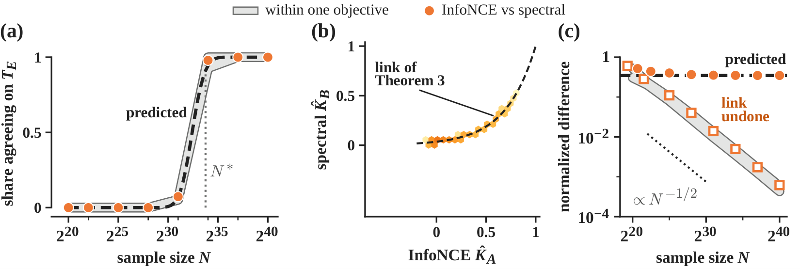</p>
<p align="center"><sub><b>Figure 6.</b> In the finite Gibbs model of Theorem 3, InfoNCE and spectral learners come to agree on order and differ in geometry by the link of the theorem.</sub></p>

> **Insight.** Our results suggest that certified minimizers of InfoNCE and of the spectral contrastive loss in the finite Gibbs model come to agree exactly on the order of distances and differ in geometry by the link, which confirms the preregistered predictions of Theorem 3 inside its premises.

**Numbers.** Exact agreement across objectives on the order of all distances among eight probe inputs held in 0 of 96 pairs up to 2<sup>28</sup> examples and in 94 of 96 at 2<sup>34</sup>, near the value N* = 2<sup>33.75</sup> predicted before the runs for agreement in 90% of pairs. At 2<sup>40</sup> examples, the largest difference of mean-normalized distances across objectives settled at a median 0.348, the limit given by the theorem. After Holm correction, all nine preregistered confirmatory predictions held, but two secondary Monte Carlo predictions failed. This experiment tests Theorem 3 and our analysis pipeline inside the premises of the theorem, not trained networks, and the sample size it needs for exact agreement on the global order (about 2<sup>34</sup> examples here) reflects how fine that criterion is rather than a practical training budget.

**Did not hold.** "The preregistered prediction failed in CIFAR-5m networks outside these premises, where at 500,000 images all 64 pairs of InfoNCE and spectral runs disagree even on neighbor sets and a fitted monotone link removes a median 15% of the residual left by an affine map, against 100% for the exact link of the theorem applied to an InfoNCE Gram matrix as a positive control."

Tests of the learning-side mechanisms on large pretrained models are left to future work.

<details>
<summary><b>Appendix figures</b></summary>

<br>

| | |
|---|---|
| **Figure F.1.** Descriptively, the crossing law recovers every slope class but predicts too shallow vision–language slopes, whereas the affine null N1 predicts every slope too steep. | 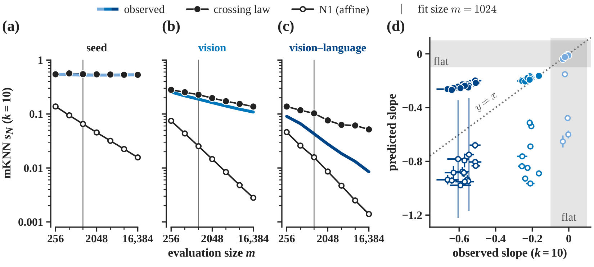 |
| **Figure F.2.** Vision–language agreement with sentence encoders falls with the evaluation size but stays close to stable at a fixed k/m, and deeper vision features raise its level. | 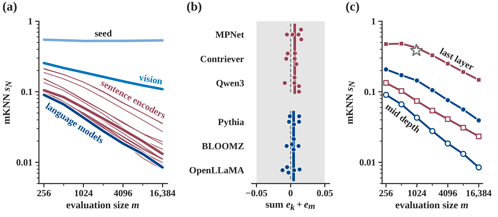 |
| **Figure F.3.** Spanning-tree overlap mostly depends on the one-nearest-neighbor scale, and the bridges exceed their null without an established size trend. | 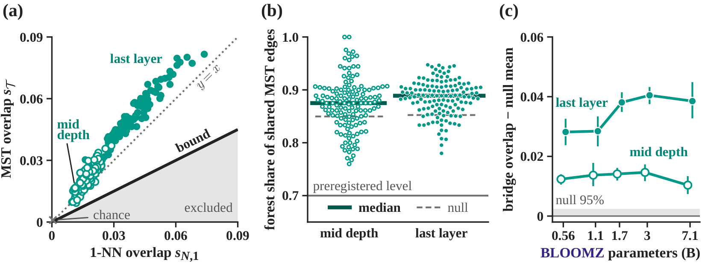 |
| **Figure F.4.** After a maximum over layers, the calibration threshold follows the largest random-pairing baseline in all three families. | 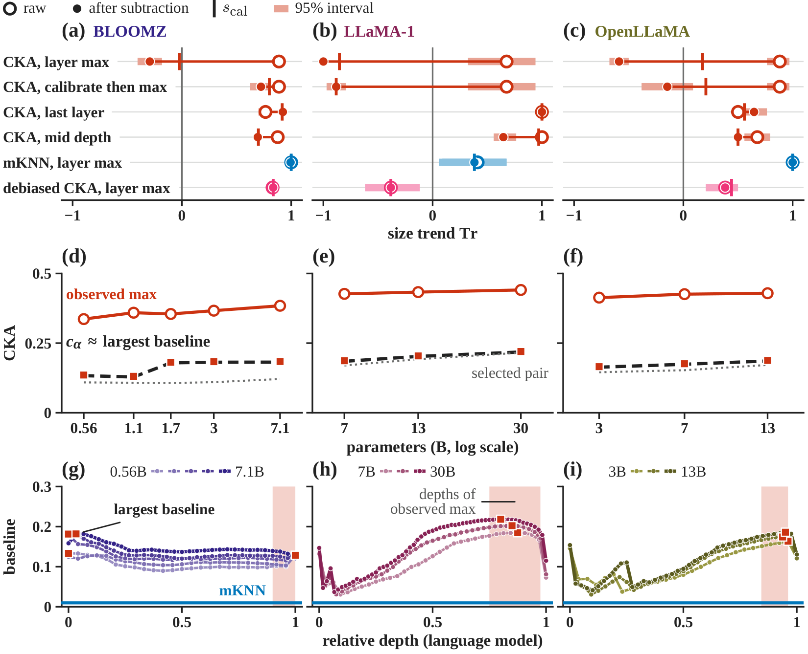 |
| **Figure F.5.** Gradient descent without a regularizer stays unreliable at every sample size on the criteria that see the gauge, whereas weight decay, tied weights, and small initialization become reliable. | 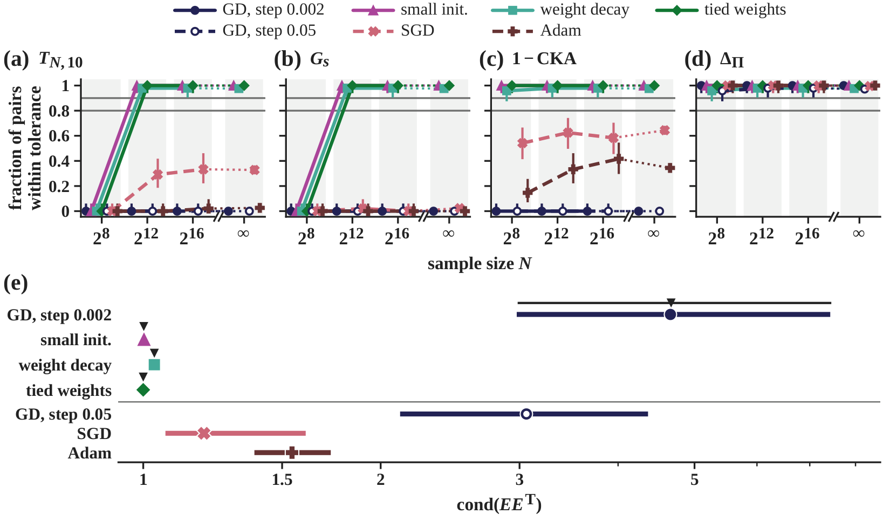 |
| **Figure F.6.** Without weight decay, the gauge of a linear head lowers agreement on scale-normalized geometry and leaves neighbor sets unchanged, and weight decay restores agreement. | 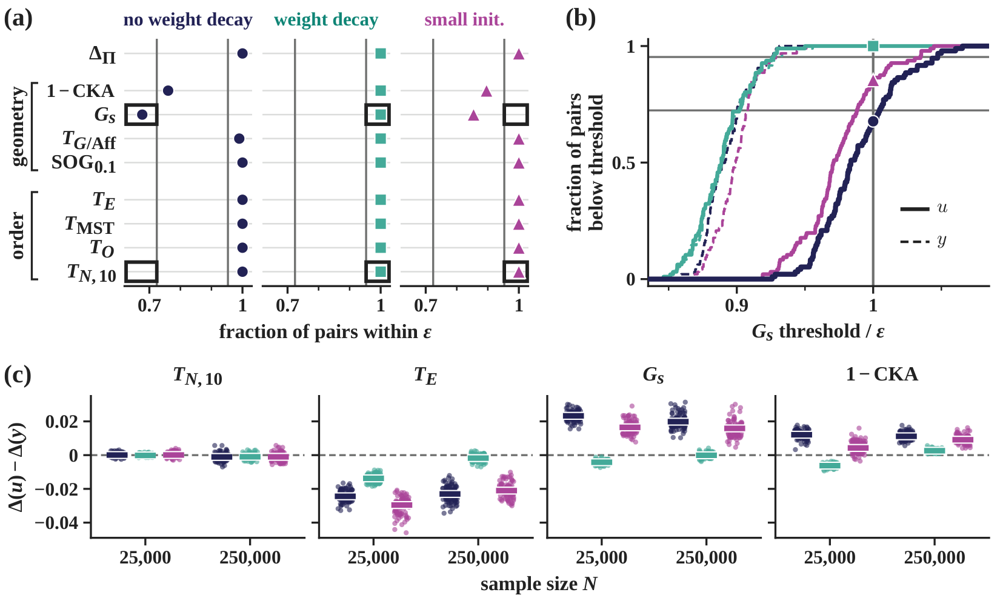 |
| **Figure F.7.** The initial imbalance kept by head flow adds less disagreement than the imbalance created by momentum, and weight decay removes the excess on G<sub>s</sub>. | 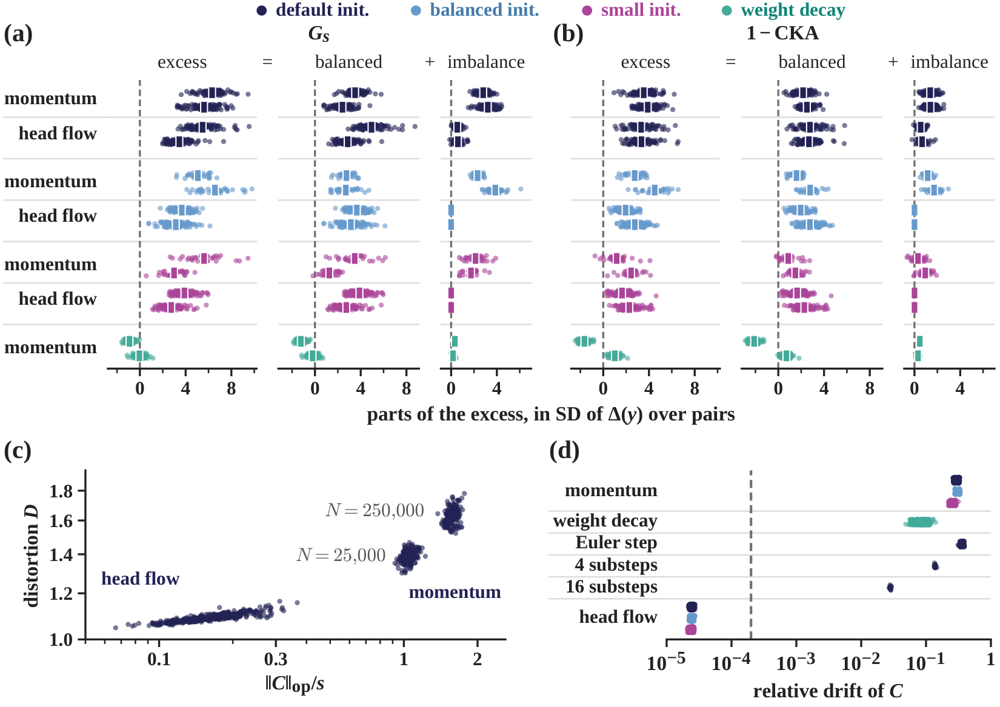 |
| **Figure F.8.** In CIFAR-5m networks, InfoNCE and spectral learners disagree on order as well as geometry, and a monotone link explains little beyond an affine map. | 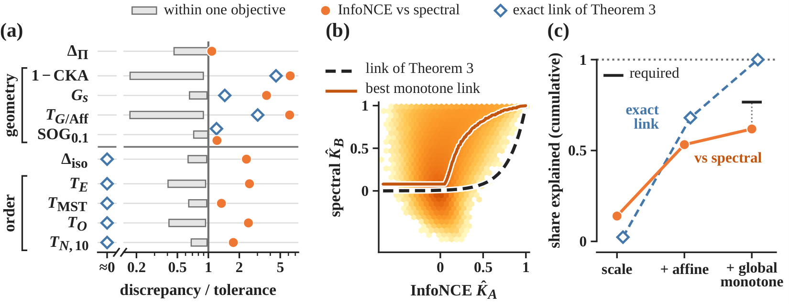 |
| **Figure F.9.** In CIFAR-5m networks, InfoNCE at either temperature and the spectral loss disagree even on order at both sample sizes, unlike the exact link of Theorem 3. | 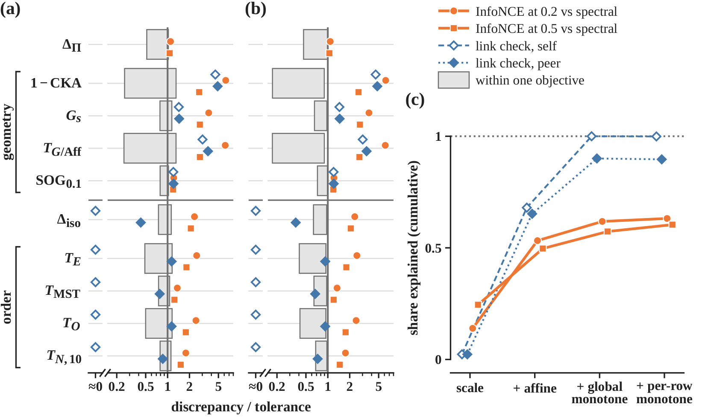 |

</details>

## Limitations and open problems

Section 6 of the paper lists the limitations, counterexamples, and open problems. In short:

- The learning results are theorems about a linear autoencoder and a finite contrastive model, and several preregistered predictions failed in trained networks outside their premises. In CIFAR-5m networks with a linear head trained without weight decay, the coordinates u agreed reliably on neighbor sets at the larger sample size, which contradicts the preregistered prediction P1 ([experiments/07](experiments/07_gauge_networks/README.md)).
- Under head flow, the coordinates of the balanced heads of two networks still disagree in geometry more than their outputs y, and Theorem 2 does not cover this excess. Most of the excess of u over y comes from a gauge shared by all networks, a source of disagreement outside Theorem 2 (exploratory).
- Networks trained with InfoNCE and with the spectral contrastive loss disagree even on neighbor sets, against the pattern of Theorem 3. InfoNCE networks at two temperatures lie outside the rescaling case of Remark 2, and the prediction derived from the co-occurrence lemma of the appendix also failed ([experiments/09](experiments/09_contrastive_networks/README.md)).
- On the measurement side, the crossing law with an estimated coupling predicts the right sign for every non-flat slope, as does an affine null, but for the vision–language pairs the agreement it predicts is too high. The vision–language mKNN scores also depend on the depth of the vision features, the text model, and the protocol.
- Each size trend rests on one draw of evaluation inputs, and the loss of the CKA trend under calibration still awaits a confirmatory test on a family that meets the condition of Corollary 1.
- The criteria of the lattice compare two representations on paired inputs. Alignment without pairs also depends on whether the correspondence can be identified from each space alone, which these criteria do not test. Tests of the learning-side mechanisms on large pretrained models are left to future work.
- Open problems: a law linking the dispersion of the coupling at the resolved scale to its dispersion at finer scales, together with a proof of Conjecture D.1; the selection of the gauge under momentum and finite steps; a model in which a change of objective alters the learned relation itself; baselines built from shared but uninformative structure, such as caption length; and a learning result that makes agreement reliable on one branch of the lattice and not on the other.

## Repository structure

The code in `stage1/`, `stage2/` and `figures/` is a byte-identical copy of the code that produced the paper's numbers, in the folder layout it ran in. Result files are byte-identical too, except 19 files in which the home-directory prefix or the host name of the experiment machine was replaced or an internal note was removed (each listed with both hashes in [`results/README.md`](results/README.md)). Ten frozen preregistration files are withheld for now (see [Preregistration](#preregistration)). It has not been re-run from this checkout, and it was run only on Linux (Ubuntu 24.04.3). The criterion library keeps its working name `hrhv2`. As a validity check, our two implementations of every criterion reproduce the published code of PRH, ARH, and SOG to within 10<sup>−6</sup> on float64 inputs.

```
LRH/
├── README.md, LICENSE, CITATION.cff, THIRD_PARTY_NOTICES.md
├── requirements.txt            experiments environment, direct dependencies (Python 3.12.3, CUDA 13.2)
├── requirements-lock.txt       experiments environment, full package list
├── requirements-figures.txt    figures environment
├── assets/                     figures of this README (Figures 1 to 6, appendix Figures F.1 to F.9)
├── experiments/                one README per experiment: question, frozen files, commands, outputs, compute
├── prereg/                     index of the frozen preregistration files and their SHA256SUMS
├── results/                    index from each number in this README to the result file it comes from
├── scripts/                    lrh_env.sh (path shim), fetch_vendor.sh, verify_prereg.sh
├── stage1/                     pretrained models and the linear autoencoder
│   ├── SPEC.md                 frozen definition of every criterion
│   ├── hrhv2/                  criterion library ("ladder" of criteria, calibration, known-answer plants) + tests
│   ├── hrhv2_ref/              independent second implementation + tests
│   ├── extract/                feature extraction (WIT, COCO, LLaMA-1, OpenLLaMA, Pythia, sentence encoders)
│   ├── analysis/               evaluation size (s11*), spanning trees and CKA (s12), layer maximum (s12_layermax*),
│   │                           sentence encoders (e0_sentence)
│   ├── linae/                  linear autoencoder
│   ├── prereg/                 Stage-1 preregistration and lead decisions
│   └── results/                reports and summaries
├── stage2/                     trained networks and the finite Gibbs model
│   ├── src/, src_v11/          CIFAR-5m networks (first and second experiment)
│   ├── s23/                    finite Gibbs model (src, amendment runners, prereg, results)
│   ├── prereg/                 Stage-2 preregistrations and frozen tolerances
│   ├── plans/, plans_v11/      run lists (seeds and configurations)
│   └── results/                reports and summaries
└── figures/                    makers of the paper's figures and tables, with the plotted numbers
```

## Installation

```bash
git clone https://github.com/EEthanShi/LRH.git && cd LRH
python3.12 -m venv stage1/venv && stage1/venv/bin/pip install -r requirements.txt
python3.12 -m venv figures/venv && figures/venv/bin/pip install -r requirements-figures.txt
bash scripts/fetch_vendor.sh      # optional: PRH, SOG and ARH reference code for the cross-checks
bash scripts/verify_prereg.sh     # sha256 of every shipped frozen preregistration file
mkdir -p stage1/logs stage2/logs  # log folders the launchers write to
scripts/lrh_env.sh bash -c 'cd ~/hrh_v2_stage1_20261008 && venv/bin/python -m pytest -q hrhv2/tests'
scripts/lrh_env.sh bash -c 'cd ~/hrh_v2_stage1_20261008/hrhv2_ref && ../venv/bin/python -m pytest -q tests'
```

The two environments differ in numpy (2.3.5 for the experiments, 2.5.3 for the figures) and must stay separate. `requirements-lock.txt` pins all 85 packages of the experiments environment.

**Paths.** The code reaches its files through the folder names it had on the experiment machine, for example `~/hrh_v2_stage1_20261008/venv/bin/python`. `scripts/lrh_env.sh` runs a command with `HOME` set to a workspace (`.lrh_home/` by default, or `$LRH_WORKSPACE`) in which those names link to this checkout: `hrh_v2_stage1_20261008` to `stage1/`, `hrh_v2_stage2_20261008` to `stage2/`, `hrh_v2_figs` to `figures/`, `hrh_v2_figs_venv` to `figures/venv`, and `hrh_finite_20260922/vendor` to `stage1/vendor` (where the ARH reference code is looked up). It also links `.cache` to your real home, so the Hugging Face cache stays where it is. No experiment file is edited. If you prefer, create the same links in your own home instead, for example `ln -s "$PWD/stage1" ~/hrh_v2_stage1_20261008`. Use the shim only for the pipelines, since it also moves other per-user state (pip and matplotlib configuration) into the workspace.

Outputs land inside the checkout through these links (`stage1/features/`, `stage2/runs/`, the `results/` folders) and are ignored by git. To keep data on a large disk, link `stage1/features`, `stage2/data` and the run folders there. Other settings the code reads: `HF_HUB_CACHE` and `HF_HUB_OFFLINE` (extraction), `S23_ROOT` (finite Gibbs model), and the thread counts `PYT_THREADS`, `OL_THREADS`, `LMX_THREADS` and `LLAMA_AXIS_THREADS`.

**Caveats.**
- The shell launchers use Linux tools (`taskset`, `flock`, GNU `find` and `stat`, `nice`, `setsid`).
- The pipelines were run step by step under an internal run log (`STATUS.md`, not part of this repository). Many launchers append to it, and several guards look for its freeze lines (for example `CODE FROZEN` or `S2.3 PREREG v1.0 + CODE FROZEN`) before they start. The shipped reports and summaries are the record of those runs. Each frozen plan gives the order of its steps and the freeze lines its guards expect.
- Guards that check plan hashes work only on byte-identical frozen files, which `scripts/verify_prereg.sh` checks. The guards of the pipelines whose frozen plans are withheld for now (sentence encoders, the OpenLLaMA and Pythia layer maximum, the second gauge-network experiment, and the finite Gibbs model and its amendments) refuse to run in this checkout.
- The figure makers also read earlier figure versions and raw run files that are not shipped. They document how each panel was drawn, and the plotted values are in each `figures/v8/F_*/numbers.json`.

## Reproducing the experiments

All runs used one machine: an NVIDIA RTX PRO 6000 Blackwell Workstation Edition GPU (97,887 MiB), an Intel Core Ultra 9 285K with 24 cores, 125 GiB of memory, and Ubuntu 24.04.3, with PyTorch 2.13.0 and CUDA 13.2. The compute below is as measured there, including contention with other jobs, not a minimum requirement. Stage 1 used about 160 GB and Stage 2 about 50 GB of disk on that machine, mostly features, model caches, and run outputs.

Every command runs through the shim, for example `scripts/lrh_env.sh bash -c 'cd ~/hrh_v2_stage1_20261008 && <command>'`. Each experiment README gives the steps in order.

| | Experiment | Paper | Entry points | Compute in the paper | Status |
|---|---|---|---|---|---|
| [00](experiments/00_criteria_library/README.md) | Criterion library and known-answer checks | Sections 2 and 3 | `stage1/hrhv2/run_g0.py` | 54.0 min wall, 10 processes (CPU) | preregistered |
| [01](experiments/01_feature_extraction/README.md) | Feature extraction (WIT, COCO pool) | Section 5.1 | `stage1/extract/build_items.py`, `prefetch.py`, `run_queue.py` | 38.7 min GPU, 66 model and dataset jobs | protocol frozen |
| [02](experiments/02_evaluation_size/README.md) | Evaluation size: estimator selection and the (m, k) test | Section 5.2, Fig. 2a, 2b, F.1 | `stage1/analysis/s11_select/run_ssel.py`, `run_plants.py`; `stage1/analysis/s11/s11v11_pipeline.sh` | 31.1 + 2.7 + about 1.5 CPU-h; 158.7 CPU-h | preregistered; crossing-law test not run |
| [03](experiments/03_sentence_encoders/README.md) | Sentence encoders; depth follow-ups | Sections 5.2 and 6, Fig. F.2 | `stage1/extract/e0_sentence/run/run_full.sh`; `stage1/analysis/e0_sentence/run/run_step5.sh`, `run_step6.sh`; `x3/`, `x3b/` | 0.38 GPU-h + 1.5 to 1.9 CPU-h; 0.04 GPU-h + about 1.5 CPU-h | preregistered (+ addendum 1); depth follow-ups exploratory |
| [04](experiments/04_spanning_trees_cka/README.md) | Spanning trees and CKA at fixed depth | Section 5.3, Fig. 2c, 3, F.3 | `stage1/analysis/s12/prep.py`, `run_pairs.py`, `aggregate.py`, `report.py` | 3.93 + 0.38 + 1.84 CPU-h | preregistered |
| [05](experiments/05_layer_max/README.md) | Layer maximum: BLOOMZ, LLaMA-1, OpenLLaMA, Pythia | Section 5.4, Fig. 4, F.4 | `stage1/analysis/s12_layermax*/`, `stage1/extract/{llama,openllama,pythia}_axis/` | BLOOMZ 1,284 s; LLaMA-1 forward 53 + 263 s; OpenLLaMA 13B forward 61 s; Pythia 15.0 GPU-min | BLOOMZ threshold analysis post hoc; others forecast before scoring |
| [06](experiments/06_linear_autoencoder/README.md) | Linear autoencoder | Section 5.5, Fig. 5a to 5c, F.5 | `stage1/linae/run_all.sh` | about 1.5 CPU-h | preregistered |
| [07](experiments/07_gauge_networks/README.md) | Gauge networks on CIFAR-5m (two experiments) | Section 5.5, Fig. 5d, 5e, F.6, F.7 | `stage2/src/launch_workers.sh`, `stage2/src/analyze.py s22`; `stage2/src_v11/pipeline_v11.py run` | 0.17 + 4.74 h summed; 9.91 + 11.01 h summed | preregistered |
| [08](experiments/08_finite_gibbs/README.md) | Finite Gibbs model | Section 5.6, Fig. 6 | `stage2/s23/src/launch_stageA.sh`; amendments in `stage2/s23/resume/` | 12.71 GPU-h | preregistered (+ amendments A1 to A4) |
| [09](experiments/09_contrastive_networks/README.md) | Contrastive networks on CIFAR-5m | Section 5.6, Fig. F.8, F.9 | `stage2/src/launch_workers.sh`, `stage2/src/analyze.py s21` | 5.05 + 30.38 h summed | preregistered; prediction failed |
| [10](experiments/10_figures_tables/README.md) | Figures and tables | all | `figures/v8/F_*/make_F_*.py`, `figures/writer/make_tables.py` | n/a | plotted values shipped |

## Data and models

All data and model weights are downloaded by the code. None is included in this repository.

- **WIT subsets** of PRH: Hugging Face [`minhuh/prh`](https://huggingface.co/datasets/minhuh/prh), revisions `wit_1024` and `wit_4096`. The original WIT dataset is at [google-research-datasets/wit](https://github.com/google-research-datasets/wit).
- **COCO pool**: [`sayakpaul/coco-30-val-2014`](https://huggingface.co/datasets/sayakpaul/coco-30-val-2014) at revision `abdde3200f533ddae5bed2438057f1f7ea2d5131`. The five captions per image for the sentence encoders come from [cocodataset.org](https://cocodataset.org) (`annotations_trainval2014.zip`, size- and md5-checked by `e0_captions.py`).
- **CIFAR-5m**: [preetum/cifar5m](https://github.com/preetum/cifar5m), parts 0 to 5 from `https://storage.googleapis.com/gresearch/cifar5m/`, downloaded and md5-checked by `stage2/src/download_cifar5m.sh` (about 18 GB).
- **Models**, from the Hugging Face Hub through timm and transformers, at the revisions pinned in `stage1/extract/registry*.py` and `stage1/extract/*_axis/registry_*.py`:
  - the 17 vision transformers of the ARH validation set, SigLIP-B/16, and DINOv2-B;
  - BLOOMZ 560m to 7b1, OpenLLaMA 3B, 7B and 13B, LLaMA-1 7B, 13B and 30B (`huggyllama/*`), Pythia 70m to 6.9b, and PolyPythia-410M seeds 1 to 9;
  - the sentence encoders all-mpnet-base-v2, facebook/contriever, and Qwen/Qwen3-Embedding-0.6B.

Each dataset and model has its own licence; LLaMA-1 weights are subject to Meta's licence. The download code removes `HF_TOKEN` from its environment and needs no token.

## Preregistration

We call an experiment preregistered if we fixed its predictions, evaluation settings, and decision rules before running it and recorded the hash and time of this plan. Each preregistered experiment froze its plan, its prediction thresholds and, where stated, the hashes of its code before scoring. The frozen files ship byte-identical, next to the code that reads them. [`prereg/README.md`](prereg/README.md) lists them with their sha256 and gives the status of each experiment: preregistered, forecast frozen before scoring, post hoc (the BLOOMZ threshold analysis), or exploratory (the depth follow-ups). Stage-2 amendment 1 and the sentence-encoder addendum ship as written.

**Withheld for now.** Ten of the 42 frozen files also hold internal working notes of the project (local file paths and notes addressed to the authors), and a frozen file cannot be edited without changing its hash. These files are withheld for now: the plans of the sentence-encoder experiment, of the OpenLLaMA and Pythia layer maximum, and of the second gauge-network experiment, the Pythia predictions, and the preregistration of the finite Gibbs model with its amendments A1 to A4. A short `*.WITHHELD.md` note stands at the path of each, and [`prereg/SHA256SUMS.withheld`](prereg/SHA256SUMS.withheld) records the sha256 of each, so any later release can be checked against the hashes recorded at the time of freezing.

```bash
bash scripts/verify_prereg.sh
```

[`results/README.md`](results/README.md) maps every number in this README to the result file it comes from.

## Citation

The paper is in preparation; the arXiv identifier will be added here on release.

```bibtex
@misc{shi2026plato,
  title         = {From Plato to Aristotle: Toward a General Theory of Representation Hypotheses},
  author        = {Shi, Dai and Han, Andi and Li, Xiaoyu and Thompson, Luke and Hern{\'a}ndez-Lobato, Jos{\'e} Miguel},
  year          = {2026},
  note          = {Preprint in preparation; the arXiv identifier will be added on release}
}
```

GitHub also reads [`CITATION.cff`](CITATION.cff).

## License

MIT, see [LICENSE](LICENSE). Third-party code and data: see [THIRD_PARTY_NOTICES.md](THIRD_PARTY_NOTICES.md).
